# HelpDesk ITSM Lab — Incident Triage, Prioritization & Escalation

A ServiceNow-style IT service desk simulation for a **fictional hospital, Meridian Lakes Health**. I work a queue of 18 realistic healthcare IT incidents as a Tier 1 Service Desk analyst: scoring priority with the ITIL **Impact × Urgency** matrix, tracking **SLAs**, resolving what Tier 1 can, and **escalating** the rest — functionally to the right resolver group and hierarchically to management when the risk calls for it.

**Live demo:** https://alhasanal.github.io/itsm-ticketing-lab/ *(after enabling GitHub Pages — see below)*

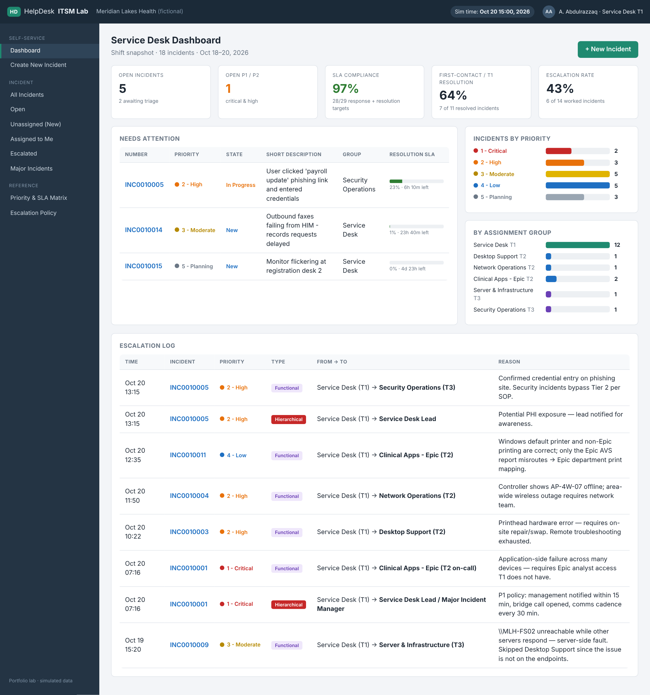

> **Lab disclaimer:** This is a simulated environment built for my portfolio. The organization, people, devices, and ticket numbers are fictional. The workflow, fields, states, and priority model mirror ServiceNow ITSM Incident Management and ITIL 4 practices.

---

## What this project shows

| Skill | Where to see it |
|---|---|
| Prioritizing with Impact × Urgency (never "gut feel") | Every ticket has a written *prioritization rationale* · [Priority & SLA guide](docs/priority-and-sla.md) |
| Re-prioritizing when facts change | INC0010004 — Wi-Fi outage raised **P3 → P2** after learning nurse call handsets were affected |
| Not letting caller title inflate priority | INC0010008 — physician's badge reader stays **P4** (one device, workaround available) |
| Major Incident handling | INC0010001 — **P1** ED Track Board outage: paging, bridge call, 30-min updates, child ticket linking, change correlation, problem record |
| Functional vs. hierarchical escalation | Escalation log on the dashboard · [Escalation SOP](docs/escalation-sop.md) |
| Escalating to the *right* group, not just the next tier | INC0010009 — file server fault sent straight to **Tier 3** |
| Security incident response at Tier 1 | INC0010005 — phishing with credential entry: preserve evidence, escalate immediately, act only on SecOps direction |
| Resolving at Tier 1 (first contact resolution) | INC0010002, 0007, 0013, 0016, 0017, 0018 |
| Incident vs. Service Request | INC0010006 — "I want a second monitor" converted to a request (RITM) |
| Honest SLA reporting | INC0010013 — response SLA breach documented with a process-improvement recommendation |
| Clear work notes & customer communication | Activity stream on every ticket separates *work notes* from *customer comments* |

### Shift metrics (from the dashboard)

- **18** incidents · **5** open · **2** awaiting triage
- **97%** SLA compliance (28 of 29 response + resolution targets met)
- **64%** first-contact / Tier 1 resolution (7 of 11 resolved incidents)
- **43%** escalation rate (6 of 14 worked incidents) — intentionally weighted toward escalation scenarios to demonstrate routing decisions

---

## Priority model

| | **Urgency 1 – High** | **Urgency 2 – Medium** | **Urgency 3 – Low** |
|---|---|---|---|
| **Impact 1 – High** | P1 Critical | P2 High | P3 Moderate |
| **Impact 2 – Medium** | P2 High | P3 Moderate | P4 Low |
| **Impact 3 – Low** | P3 Moderate | P4 Low | P5 Planning |

| Priority | Response | Resolution | Customer updates |
|---|---|---|---|
| P1 Critical | 15 min | 4 h | Every 30 min |
| P2 High | 30 min | 8 h | Every 60 min |
| P3 Moderate | 2 h | 24 h | Daily |
| P4 Low | 8 h | 72 h | On change |
| P5 Planning | 24 h | 5 days | On change |

Full definitions and scoring examples: [docs/priority-and-sla.md](docs/priority-and-sla.md)

---

## Screenshots

### Incident queue — sorted by priority, with live SLA bars
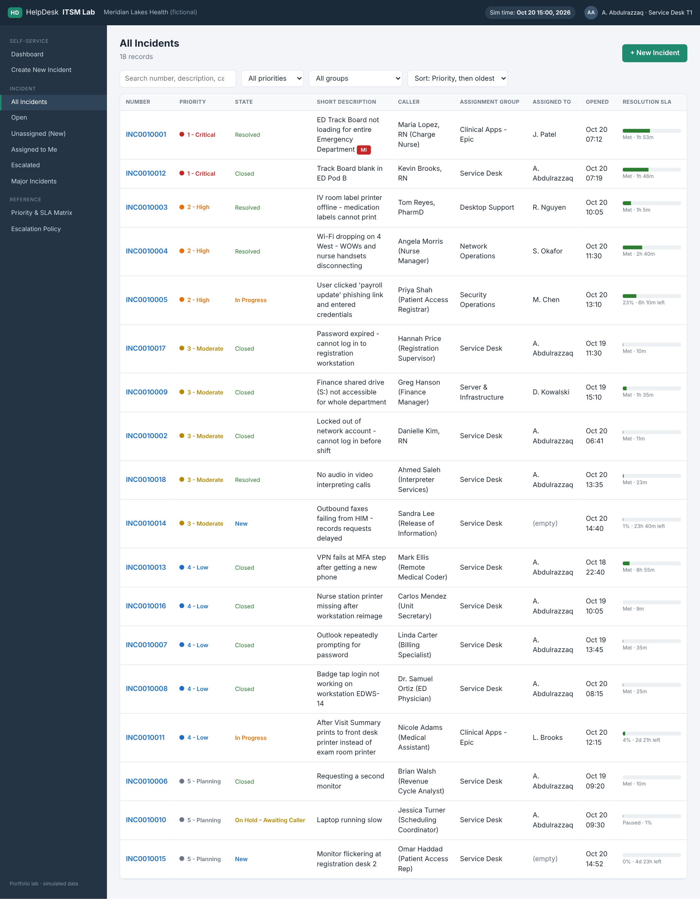

### P1 Major Incident — ED Track Board outage
Functional escalation to the Epic team plus hierarchical escalation to the Major Incident Manager, linked child ticket, related change and problem records.
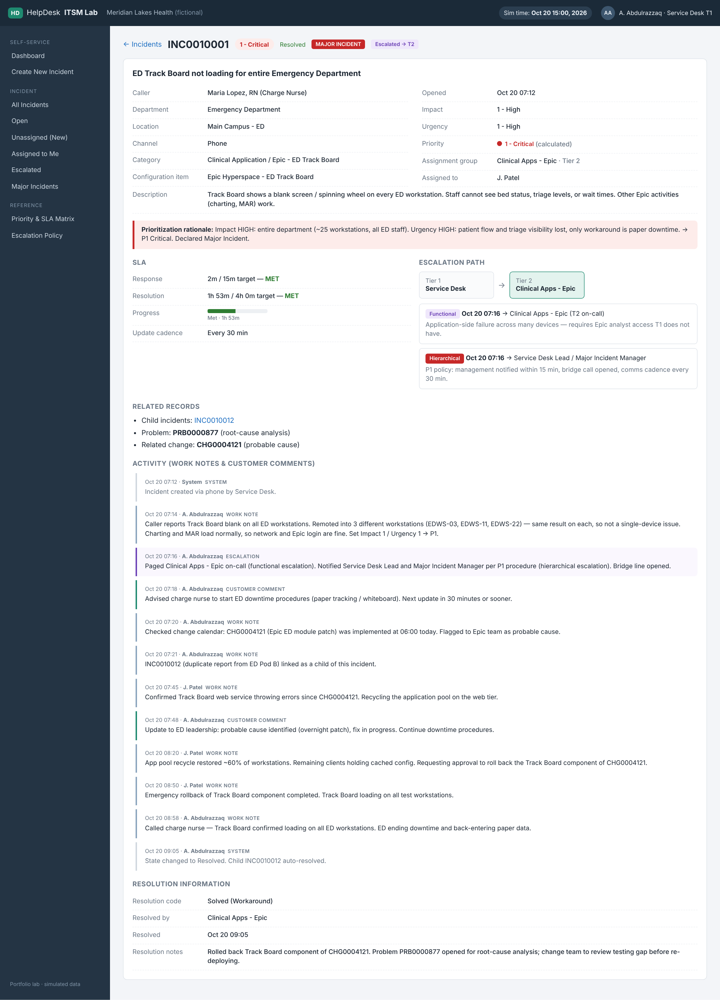

### Security escalation — phishing with credentials entered
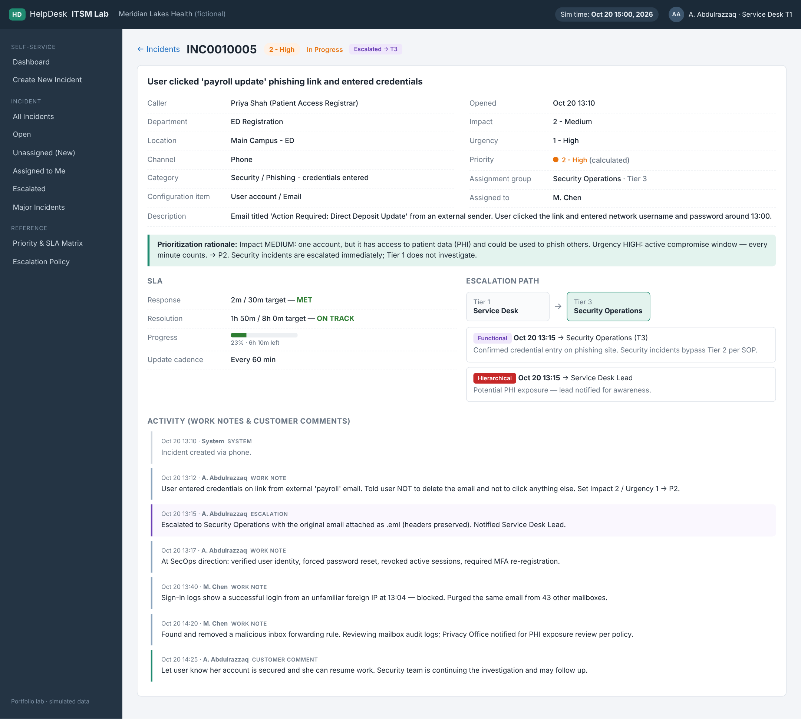

### Re-prioritization — P3 raised to P2 when new facts came in
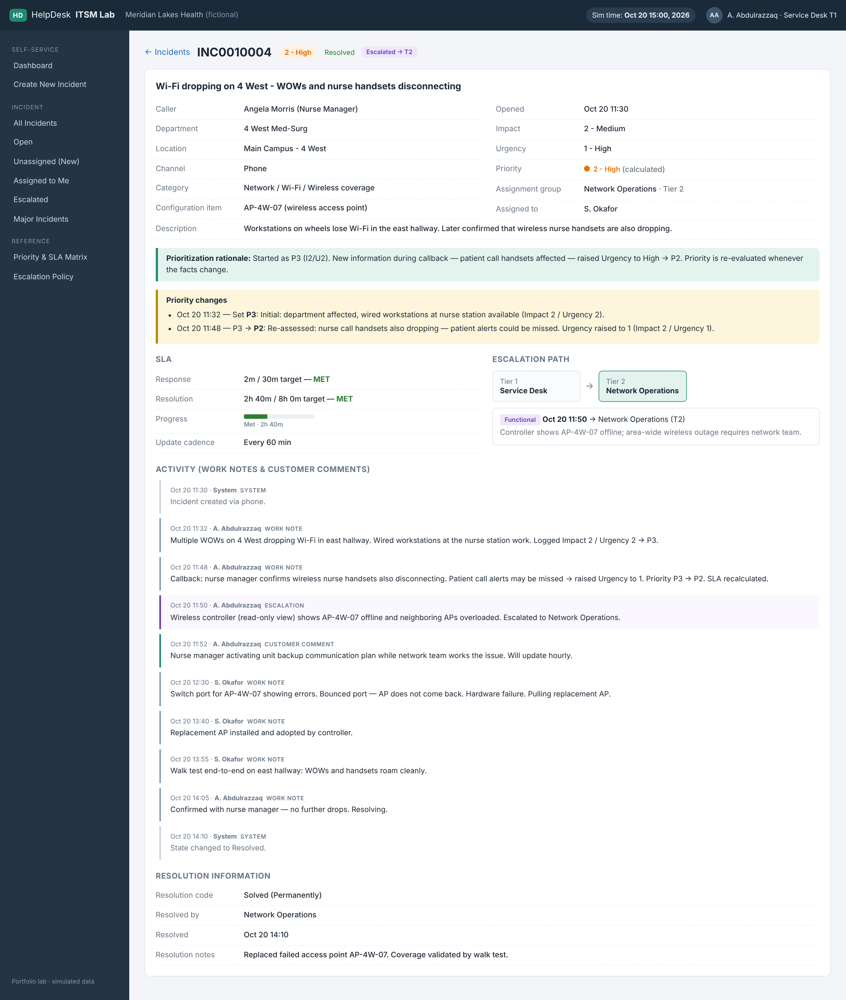

### Tier 1 first-contact resolution — account lockout before shift change
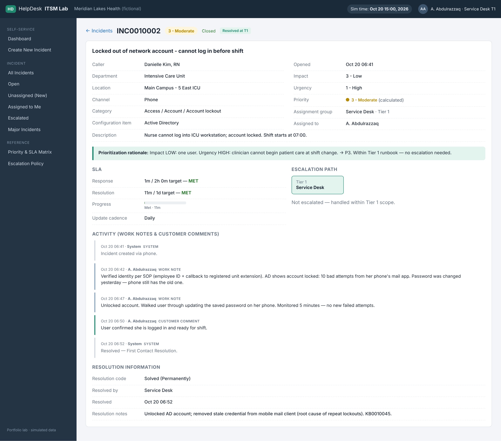

### New incident triage assistant — priority is calculated, routing is suggested
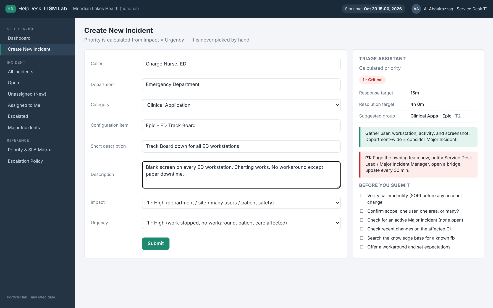

### Priority & SLA matrix
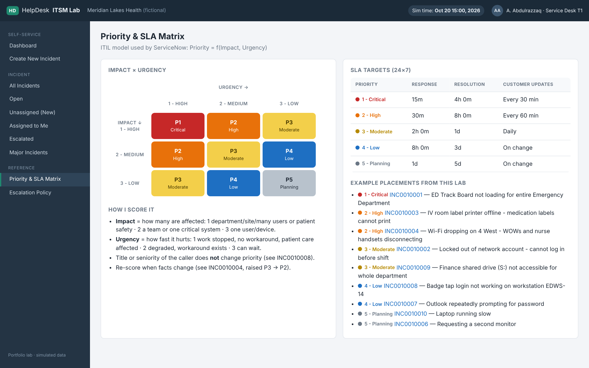

### Escalation policy
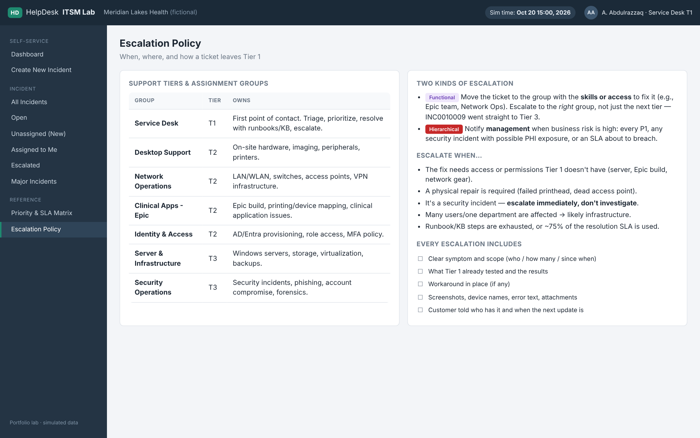

### Honest SLA reporting — a response breach, documented with a fix
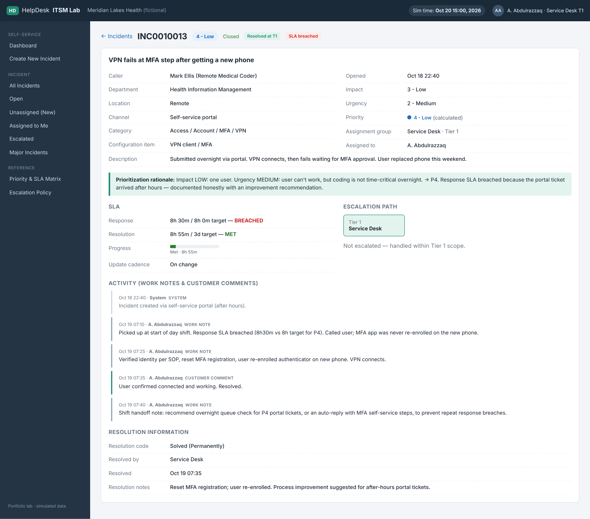

### Escalated incidents view
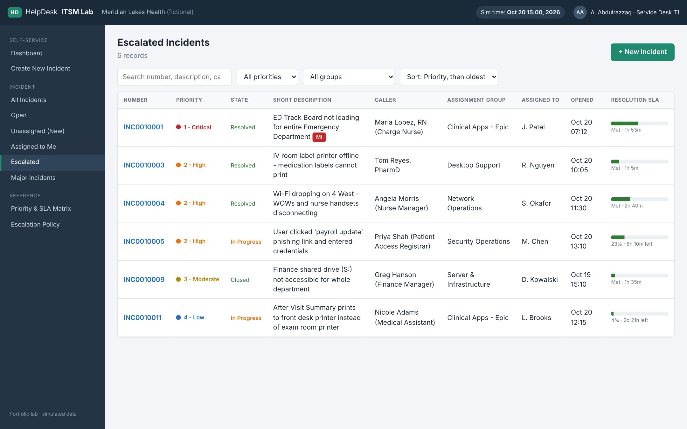

---

## Documentation

- [Ticket walkthroughs](docs/ticket-walkthroughs.md) — how and why each key ticket was prioritized, worked, and resolved or escalated
- [Escalation SOP](docs/escalation-sop.md) — tiers, assignment groups, when and how to escalate
- [Priority & SLA guide](docs/priority-and-sla.md) — scoring rules and examples
- [Portfolio & interview notes](docs/portfolio-notes.md) — summary, resume bullets, talking points

---

## Run it

No build step and no dependencies — plain HTML, CSS, and JavaScript.

1. Clone or download the repo.
2. Open `index.html` in any modern browser.

**Publish on GitHub Pages:** repo **Settings → Pages → Build and deployment → Deploy from a branch → `main` / `(root)` → Save**. The site appears at `https://<username>.github.io/itsm-ticketing-lab/` within a minute or two.

The simulation clock is fixed at **Oct 20, 2026 15:00** so SLA timers are reproducible. Tickets created on the *Create New Incident* page live in memory and reset on refresh.

## Project structure

```
itsm-ticketing-lab/
├── index.html          # App shell (top bar, navigator, main view)
├── css/styles.css      # Styling, priority colors, responsive layout
├── js/data.js          # Priority matrix, SLA targets, groups, 18 incidents
├── js/app.js           # Router, dashboard, queue, incident form, triage assistant
├── docs/               # SOP, priority guide, walkthroughs, portfolio notes
└── screenshots/        # Images used in this README
```

## Tech

HTML5 · CSS (Grid/Flexbox, CSS variables) · vanilla JavaScript (hash routing, no frameworks) · Playwright for screenshots

## Concepts

ITIL 4 Incident Management · ServiceNow Incident states (New, In Progress, On Hold, Resolved, Closed) · Impact/Urgency/Priority · SLA response and resolution targets · functional and hierarchical escalation · Major Incident process · parent/child incidents · Problem and Change correlation · Incident vs. Service Request · first contact resolution · knowledge base references · identity verification before account changes
